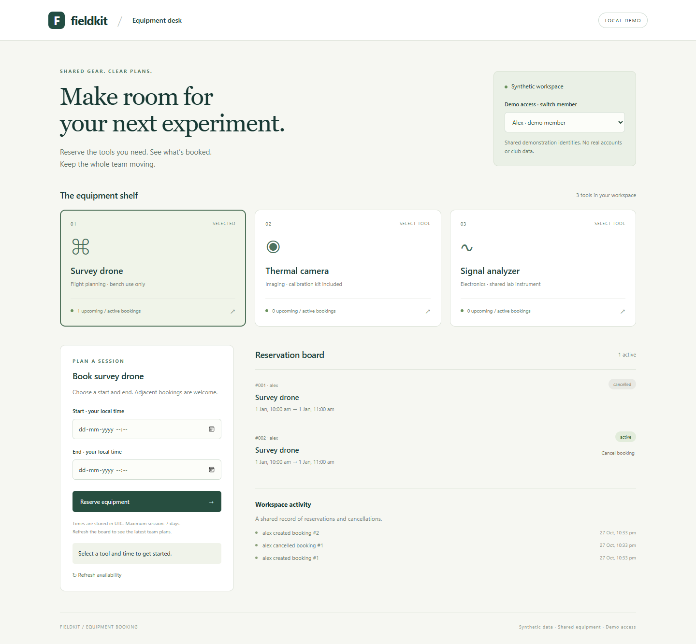

# Fieldkit · Equipment Booking

A small shared-equipment desk for a fictional student lab. Pick a tool, reserve a time and see everyone’s plans. Built to explore the failure that matters most in a booking system: two members clicking Reserve at the same time.



## What works

- Three fictional tools, two clearly labeled demo identities, responsive React/TypeScript UI.
- UTC half-open intervals: a booking ending at 11:00 permits one starting at 11:00.
- SQLite write transaction protects overlap detection, creation, request-key recording and audit together.
- Safe request retries, conflict messages, owner-only cancellation and persistent change history.
- A bounded database-busy response instead of an unhandled lock error.

Demo identities are shared selectors, **not production authentication**. Anyone with local access can select Alex or Sam. No real club/member data, flight control or real equipment integration is included.

## Run locally on Windows

Requires Python 3.12 and Node 22.12–25 (verified locally with Python 3.12.10 / Node 25.5.0). From this folder in PowerShell:

```powershell
python -m venv .venv
.\.venv\Scripts\python.exe -m pip install pip==26.2.2
.\.venv\Scripts\python.exe -m pip install -r requirements-dev.txt
cd frontend
npm.cmd ci
npm.cmd run build
cd ..
.\.venv\Scripts\python.exe -m uvicorn booking:app --host 127.0.0.1 --port 8765
```

Open http://127.0.0.1:8765. No generated Python launcher or PowerShell activation script is needed. On macOS/Linux use `.venv/bin/python`, `npm` and the same module invocation. CI checks Windows and Linux.

The default `booking.db` is created in the working directory and ignored by Git. Set the process environment variable `BOOKING_DB` to an absolute local path to keep it elsewhere. Restarting the server preserves bookings; use a new database path for a separate disposable demo. Build the frontend before starting the server. The backend serves its built assets on the same origin; no separate frontend server is needed.

The lockfile uses Rollup’s official WebAssembly package. This avoids the native addon rejected by Windows Application Control on the verification machine; security settings remain enabled. Do not unblock rejected files. Python transitive versions are constrained in `constraints.txt`; npm’s exact dependency tree is in `frontend/package-lock.json`.

## Verify

```powershell
New-Item -ItemType Directory -Force test-results | Out-Null
.\.venv\Scripts\python.exe -m pytest -q --basetemp=./test-results/pytest
cd frontend
$env:BROWSER_CHANNEL='msedge' # use installed Edge locally
npm.cmd run test:smoke
```

Without `BROWSER_CHANNEL`, install Playwright Chromium with `npx playwright install chromium`. The smoke script starts a real server with a separate temporary SQLite database, uses the browser to reserve/conflict/cancel/rebook, restarts the actual server process, verifies persistence, checks mobile overflow, saves genuine captures and executes **10 rounds of 12 concurrent TCP requests**. It does not alter your normal database. A free local port 8765 is required; override with `SMOKE_PORT`.

`docs/smoke-results.json` records the executed workload and environment; elapsed time covers the whole race loop and is not a throughput/latency benchmark. [Verification details](docs/VERIFICATION.md), [architecture and API contract](docs/ARCHITECTURE.md), [mobile capture](docs/mobile.png).

## Design decisions and limits

FastAPI/Pydantic validate timezone-aware intervals; React handles the small UI; SQLite WAL and `BEGIN IMMEDIATE` serialize writers. The hard part is keeping the availability check in the same transaction as the insert, and keeping a retry from creating a second booking after cancellation. Tests exercise independent connections, a real TCP server, injected audit failures and a held writer lock.

This is a single-host local demonstration, not a multi-host scheduling service. All reservations are visible to both demo members. Sessions are limited to seven days; historical dates are allowed for reproducible examples. Recurring reservations, real authentication, rate limits, archive/pagination policies and migration tooling are outside v1. Direct database writes bypass application invariants. A production service would need authenticated identities, authorization policy, migrations, operational limits and backup/recovery procedures.

No hosted deployment is claimed. No configured persistent-volume hosting target was supplied; GitHub Pages cannot run the Python/SQLite service. A public mutable demo would also require isolated disposable storage and abuse controls beyond these shared local identities. The runnable local demo and captures are the delivered preview, without creating a paid hosting account.

MIT licensed. All seeded names/equipment are fictional.
